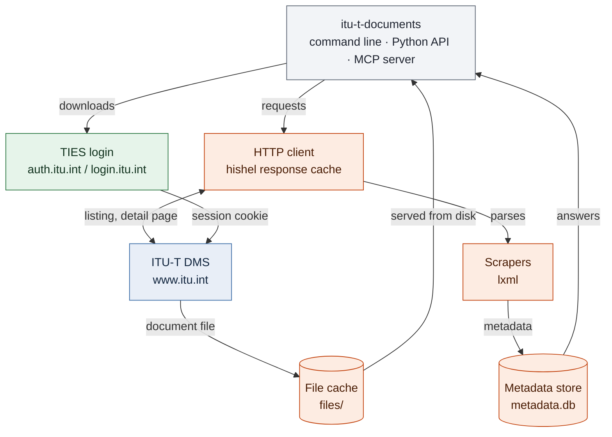

# ITU-T Documents

> Download and query ITU-T meeting documents (contributions, temporary documents, collective letters, reports) via API, CLI and MCP.

<p align="center">
  <a href="https://github.com/jr2804/itu-t-documents/actions/workflows/ci.yml"></a>
  <a href="LICENSE"></a>
  
</p>

The documents of the ITU-T study groups live in the ITU-T Document Management
System (DMS). Their metadata is public — the number, the title, the sources,
the questions — but most of the files behind it are protected by the TIES
access control and need an account.

`itu-t-documents` reads that metadata, keeps it in a local SQLite database and
downloads the documents on demand. Everything it has seen stays on disk, so
the second question about a meeting is answered without a request to
`www.itu.int` and without a login.

## What it does

- **Every document type** — contributions (`C`), temporary documents (`TD`),
  collective letters (`COL`) and reports (`R`), with their number, title,
  sources, questions and posting date.
- **The structure of the ITU-T** — the study periods, the study groups, the
  working groups, the questions under study and their rapporteurs. The
  structure changes from period to period, so it is read from the ITU-T and
  never hard coded.
- **Complete listings** — a listing is read per sub-type and compared with the
  number of documents the ITU-T reports, so a truncated listing is never
  stored as if it were complete.
- **TIES authentication** — the SAML handshake against `auth.itu.int` and
  `login.itu.int` is performed automatically, once per session.
- **Local caches** — the raw HTTP responses are cached with
  [hishel](https://hishel.com/), the metadata in a SQLite database and the
  downloaded documents on disk.
- **Three interfaces** — one command line tool, one Python API and one MCP
  server for AI agents, all on top of the same caches.

## Install

The package needs **Python 3.13 or newer**. The free-threaded build of
CPython 3.14 is supported as well.

From a clone:

```bash
git clone https://github.com/jr2804/itu-t-documents.git
cd itu-t-documents
mise dev              # syncs the environment with every extra and group
uv run itu-t-documents --help
```

`mise dev` runs `uv sync -U --dev --all-extras --all-groups`; without
[mise](https://mise.jdx.dev/) the plain `uv sync --dev --all-extras
--all-groups` does the same. From a clone, every command in this README is
run with `uv run` in front of it.

Every push to `main` is a release: the workflow tags the commit with the next
[CalVer](https://calver.org/) version, builds the artifacts and publishes them
to PyPI as `itu-t-documents`. The first release is cut by the next push to
`main`, and from then on the published version installs with:

```bash
uv tool install itu-t-documents
```

## Quick start

List the meetings of a study group — no account needed:

```bash
itu-t-documents meetings --study-group 12
```

```text
270119  Geneva, 19 January - 27 January 2027
261015  E-Meeting, 15 October 2026
260609  Geneva, 09 June - 17 June 2026
250909  Geneva, 09 September - 18 September 2025
250325  E-Meeting, 25 March 2025
250114  Geneva, 14 January - 23 January 2025
```

Fetch the documents of one of them into the local database:

```bash
itu-t-documents sync --study-group 12 --meeting 260609
```

```text
260609: 191 documents
191 documents stored in /home/you/.cache/itu-t-documents/metadata.db
```

The count is what the run added; a second run of the same meeting adds
nothing. Without `--meeting`, `sync` also reads the period-wide listing,
which finds a document posted between meetings.

Search what was stored — this never touches the network:

```bash
itu-t-documents documents --study-group 12 --question 5 --limit 3
```

```text
T25-SG12-270119-TD-GEN-0617      TD   Q5          Report of Question 5/12 interim meeting (e-meeting, 3 Novemb   Rapporteur Q5/12
T25-SG12-270119-TD-GEN-0587      TD   Q5          Status report of Question 5/12: Telephonometric methodologie   Rapporteur Q5/12
T25-SG12-270119-TD-GEN-0544      TD   Q5,13       LS/i on initiation of draft new Recommendation ITU-T H.IPTV-   ITU-T Study Group 21
```

The most prolific sources of the last three stored meetings:

```bash
itu-t-documents top-sources --study-group 12 --last-meetings 3 --limit 5
```

```text
    28  TSB
    20  ITU-T Study Group 13
    19  ITU-T Study Group 12
    16  ITU-T Study Group 21
    14  ITU-T Study Group 11
```

Download a document. This is the one step that needs a TIES account:

```bash
itu-t-documents download --document T25-SG12-COL-0001 --format MSW --language F
```

The file is written into the file cache and its path is printed. Add
`--output-file ~/report.docx` to write it somewhere else.

## How it works



Four facts make the package behave the way it does:

- **Only the download needs an account.** The meetings, the questions, the
  structure of a study group and the metadata of every document are public.
- **The HTTP cache follows the rules of RFC 9111.** It honours the caching
  headers of the ITU-T, so a page is fetched again when the site says it
  changed.
- **A listing is never stored half.** The number of documents the ITU-T
  reports is compared with the number that was parsed; an incomplete listing
  is refused instead of being stored silently.
- **The caches do not expire.** A document that was downloaded once is served
  from the disk, and a question about a meeting that was synchronised is
  answered from the database.

The URL layout, the numbering scheme and the authentication chain of the DMS
are written up in [the reference](docs/reference/itu-dms.md).

## The three interfaces

### Command line

| Command | What it does |
|---------|--------------|
| `default` | print a short introduction to the package |
| `periods` | list the study periods the ITU-T knows |
| `study-groups` | list the study groups of a period |
| `structure` | the plenary, the working groups, the questions and the other groups of a study group |
| `search` | search the working groups, the questions and the other groups |
| `meetings` | list the meetings of a study group |
| `questions` | list the questions under study, with their working group and their rapporteurs |
| `sync` | fetch the documents of a meeting into the local database |
| `documents` | search the documents in the local database |
| `top-sources` | count the most prolific sources of the stored meetings |
| `download` | download a document |
| `auth` | check whether the TIES credentials are configured and usable |
| `mcp` | run the MCP server over stdio |

The options:

| Option | Commands | Meaning | Default |
|--------|----------|---------|---------|
| `--study-group`, `-g` | `structure`, `meetings`, `questions`, `sync`, `documents`, `top-sources` | the study group, e.g. `12` | `12` |
| `--study-period`, `-p` | `study-groups`, `structure`, `meetings`, `questions`, `sync`, `search`, `top-sources` | the study period, e.g. `2025-2028` | the current period, `2025-2028` |
| `--study-period`, `-p` | `documents` | the study period to search in, e.g. `2025-2028` | every period |
| `--meeting`, `-m` | `sync`, `documents` | a meeting, given by its DMS code, e.g. `270119` | every meeting |
| `--type` | `sync` | the document type to fetch: `TD`, `C`, `COL` or `R` | `C` and `TD` |
| `--type` | `documents` | the document type to search for: `TD`, `C`, `COL` or `R` | every type |
| `--question`, `-q` | `documents` | a question number, e.g. `5` for `Q5/12` | every question |
| `--source`, `-s` | `documents` | a submitting organisation; the match is partial | every source |
| `--last-meetings` | `top-sources` | how many of the most recent stored meetings to count | `3` |
| `--limit`, `-l` | `documents`, `top-sources` | the maximum number of results | `documents`: no limit; `top-sources`: `10` |
| `--search`, `-s` | `search` | the text to look for, e.g. `speech` | required |
| `--document` | `download` | the DMS identifier | required |
| `--format` | `download` | `PDF`, `MSW` (Word), `ZIP` or `HTM` | `PDF` |
| `--language` | `download` | `E`, `F`, `S`, `A`, `C` or `R` | `E` |
| `--output-file`, `-o` | `download` | a path to write the document to | the file cache |

The study group, the study period, the meeting and the output file can also
be set in the environment:

```bash
export ITU_T_DOCUMENTS_STUDY_GROUP=12
export ITU_T_DOCUMENTS_STUDY_PERIOD=2025-2028
export ITU_T_DOCUMENTS_MEETING=261015
export ITU_T_DOCUMENTS_OUTPUT_FILE=~/Documents/itu
```

Every command and every option is documented in
[the guide to the command line](docs/cli.md).

### Python API

```python
from itu_t_documents import DocType, ItuDocuments, MeetingId, StudyPeriod

with ItuDocuments() as api:
    period = StudyPeriod.from_year(2025)

    # Fetch the documents of a meeting and store them locally
    api.sync_meeting(12, MeetingId.from_code("260609"), period, (DocType.CONTRIBUTION, DocType.TEMPORARY_DOCUMENT))

    # All temporary documents of Q5/12
    for document in api.documents_for_question(study_group=12, question=5, doc_type=DocType.TEMPORARY_DOCUMENT):
        print(document.document_id, document.title)

    # The most prolific sources of the last three stored meetings
    for source in api.top_sources(study_group=12, last_meetings=3):
        print(source.count, source.source)
```

The structure of the ITU-T lives in its own object:

```python
from itu_t_documents import ItuCatalogue, StudyPeriod

with ItuCatalogue() as catalogue:
    period = StudyPeriod.from_year(2025)

    [group.code for group in catalogue.study_groups(period)]
    # ['SG02', 'SG03', 'SG05', 'SG11', 'SG12', 'SG13', 'SG15', 'SG17', 'SG20', 'SG21']

    structure = catalogue.structure(12, period)
    structure.question(5).title
    # 'Telephonometric methodologies for handset and headset terminals Continuation of Q5/12'

    structure.question(99)
    # UnknownEntityError: SG12 has no question Q99/12
```

See [the guide to the Python API](docs/python-api.md) for the models, the
metadata store, the file cache and the errors.

### MCP server

```bash
itu-t-documents mcp
```

The server speaks the Model Context Protocol over stdio. It opens no port and
holds no state of its own — everything it knows is in the local database of
the package. A search tool synchronises only what the store lacks, so a
question about stored data is answered offline.

| Tool | Answers |
|------|---------|
| `list_meetings` | *"When does SG12 meet?"* |
| `list_questions` | *"Which questions are under study?"* |
| `documents_for_question` | *"Show me all TDs of Q5/12 at meeting XYZ"* |
| `contributions_by_source` | *"Which contributions were made by company XYZ in study group 12?"* |
| `top_sources` | *"Which source submitted the most documents (TD + C) to the last three meetings?"* |
| `search_documents` | *"Show me the contributions of Huawei in SG12"* |
| `download_document` | *"Download the collective letter of SG12 in French"* |
| `list_periods` | *"Which study periods are there?"* |
| `list_study_groups` | *"Which study groups does the ITU-T have?"* |
| `list_structure` | *"Which working groups does SG13 have?"* |
| `search_structure` | *"Which working group deals with speech?"* |

Register it with an agent:

```bash
claude mcp add itu-t-documents -- itu-t-documents mcp
```

See [the guide to the MCP server](docs/mcp.md).

## Document identifiers

Every document is addressed by study period, study group, document type and an
increasing number. Temporary documents carry the meeting and a sub-type:

| Type | Identifier | Example |
|------|------------|---------|
| Contribution | `T{sp}-SG{sg}-C-{number}` | `T25-SG12-C-0192` |
| Temporary document | `T{sp}-SG{sg}-{meeting}-TD-{subtype}-{number}` | `T25-SG12-261015-TD-GEN-0520` |
| Collective letter | `T{sp}-SG{sg}-COL-{number}` | `T25-SG12-COL-0001` |
| Report | `T{sp}-SG{sg}-R-{number}` | `T25-SG12-R-0001` |

`T25` is the study period `2025-2028`, `SG12` the study group, `261015` the
meeting (15 October 2026) and `0520` the number of the document. Contributions,
collective letters and reports are numbered across the whole study period, so
their identifier carries no meeting. The numbers are not consecutive — a
withdrawn document leaves a hole — and the number of a temporary document runs
per sub-type over the whole study period.

A document is published in the format it was submitted in, so the format and
the language of a download have to match what the DMS offers for that
document. `T25-SG12-COL-0001`, for example, is available as `MSW` in six
languages; the package picks the rendition that matches and prefers the
original over a revision.

## TIES credentials

Downloading a document needs a [TIES](https://www.itu.int/hub/membership/user-account-ties/)
account. The credentials are read from the environment:

```bash
export ITU_TIES_USERNAME="you@example.org"
export ITU_TIES_PASSWORD="secret"
```

or from `~/.config/itu-t-documents/config.toml`:

```toml
[credentials]
username = "you@example.org"
password = "secret"

[general]
cache_dir = "~/.cache/itu-t-documents"
timeout = 30
```

A third, lowest priority source is a
[secretspec](https://github.com/cachix/secretspec) provider, which is installed
with the optional extra `uv sync --extra secretspec`. Without the extra, or
without a matching provider, it is ignored silently.

Check that the account works with:

```bash
itu-t-documents auth
```

```text
TIES login succeeded.
```

A TIES account is valid for the whole ITU-T, but its membership covers only
the study groups it belongs to. The metadata of a document is public and is
read without a login, but the file is not: a document outside the membership
answers `401 Unauthorized` with a page that blames invalid credentials, which
is not what happened. The package reports that as a missing membership:

```text
$ itu-t-documents download --document T25-SG13-C-0001 --format MSW
itu-t-documents: T25-SG13-C-0001 is not accessible with these credentials; the membership of the TIES account does not cover SG13
```

The configuration file, the secretspec provider and every way to store a
password are described in [getting started](docs/getting-started.md).

## Caches

Everything the package has seen stays on disk:

| Path | Content |
|------|---------|
| `~/.cache/itu-t-documents/metadata.db` | The SQLite metadata store |
| `~/.cache/itu-t-documents/http-cache.sqlite` | The raw HTTP responses (hishel) |
| `~/.cache/itu-t-documents/files/` | The downloaded documents |

The cache directory is set with `ITU_CACHE_DIR` or the `general.cache_dir` key
of the configuration file.

## What it does not do

- It only reads. The package never writes to the ITU-T.
- It does not judge the documents. It reports the metadata the DMS publishes.
- It cannot see what the account may not see. A document outside the
  membership of the account is refused, and the ITU-T answers such a request
  with `401 Unauthorized`.
- It does not know the structure of the ITU-T by heart. The study groups, the
  working groups and the questions change from period to period, so they are
  read from the ITU-T, and an entity that does not exist is refused instead
  of returning an empty result that looks like an answer.

## Documentation

The full documentation lives in [`docs/`](docs/index.md) and is built with
[zensical](https://github.com/jr2804/zensical).

| Page | What it holds |
|------|---------------|
| [Getting started](docs/getting-started.md) | installing the package, the TIES account, the first steps, troubleshooting |
| [The command line](docs/cli.md) | every command and every option |
| [The Python API](docs/python-api.md) | the API, the models, the catalogue, the caches, the errors |
| [The MCP server](docs/mcp.md) | the tools and the questions they answer |
| [The catalogue of the ITU-T](docs/catalogue.md) | the study periods, the study groups, the working groups, the questions |
| [The ITU-T DMS](docs/reference/itu-dms.md) | the URL layout and the numbering scheme, as they were measured |
| [API reference](docs/reference/api.md) | the generated reference of every public class and function |

### For AI agents

The repository ships a skill that teaches an agent the package: the CLI, the
Python API and the MCP server, the vocabulary of the ITU-T and the errors a
user hits.

```bash
bun x skills add https://github.com/jr2804/itu-t-documents
```

It lives in [`skills/itu-t-documents/`](skills/itu-t-documents/SKILL.md) and
is verified with
[skill-check](https://github.com/thedaviddias/skill-check).

## Contributing

Contributions are welcome. Open an issue before a large change, so the
approach can be discussed, and send a pull request for the rest.

```bash
git clone https://github.com/jr2804/itu-t-documents.git
cd itu-t-documents
mise dev          # installs the tools and syncs the environment
mise test         # pytest with the 100% coverage gate
mise lint         # ruff
mise all          # test, lint, spell, format, format-md and docs in one pass
```

The [contributing guide](docs/contributing.md) describes the setup, the
quality gates and the conventions of the project, and the
[code of conduct](docs/code_of_conduct.md) says how to behave in it.

## Development

| Command | What it does |
|---------|--------------|
| `mise dev` | sync the development dependencies |
| `mise test` | pytest with the 100% coverage gate |
| `mise lint` | ruff, with the fixes applied |
| `mise typecheck` | ty, the static type checker |
| `mise spell` | codespell over the source and the tests |
| `mise format` | reorder, format and sort the imports |
| `mise format-md` | reformat the Markdown with rumdl |
| `mise docs` | build the documentation site |
| `mise version` | print the version the build backend resolves |
| `mise all` | test, lint, spell, format, format-md and docs, in one pass |

The version of the package is a [CalVer](https://calver.org/) version —
`YYYY.MM.N`, e.g. `2026.11.1` — and it is derived from the git tag, never
written into `pyproject.toml`. Every push to `main` is a release; the
procedure is documented in [docs/release.md](docs/release.md).

### Built with

| Layer | Tool | Purpose |
|-------|------|---------|
| Package manager | [uv](https://docs.astral.sh/uv/) | Fast installs, deterministic lockfile |
| Task runner | [mise](https://mise.jdx.dev/) | DAG-based tasks, tool version management |
| Linter + formatter | [ruff](https://docs.astral.sh/ruff/) | Single-binary code quality |
| Type checker | [ty](https://github.com/google/ty) | Strict type checking |
| Testing | [pytest](https://pytest.org/) | Test framework with 100% coverage gate |
| CLI | [Cyclopts](https://cyclopts.readthedocs.io/) | Type-driven CLI parsing and shell completion |
| HTTP | [httpx](https://www.python-httpx.org/) | HTTP client with the TIES session |
| HTTP cache | [hishel](https://hishel.com/) | RFC 9111 compliant response cache |
| Database | [SQLModel](https://sqlmodel.tiangolo.com/) | Typed SQLite metadata store |
| Settings | [pydantic-settings](https://docs.pydantic.dev/latest/concepts/pydantic_settings/) | Layered configuration |
| Parsing | [lxml](https://lxml.de/) | HTML parser for the ITU-T pages |
| MCP | [FastMCP](https://gofastmcp.com/) | Model Context Protocol server |
| Spell check | [codespell](https://github.com/codespell-project/codespell) | Code and doc spell checking |
| Documentation | [Zensical](https://github.com/zensical/zensical) | MkDocs Material with executable examples |
| Versioning | [uv-dynamic-versioning](https://github.com/ninoseki/uv-dynamic-versioning) | Git tag-based versioning |
| Hooks | [pre-commit](https://pre-commit.com/) | Automated quality gate |

## License

MIT — see [LICENSE](LICENSE) for details.

---

Generated from [copier-uv-plus](https://codeberg.org/jr2804/copier-uv-plus).
